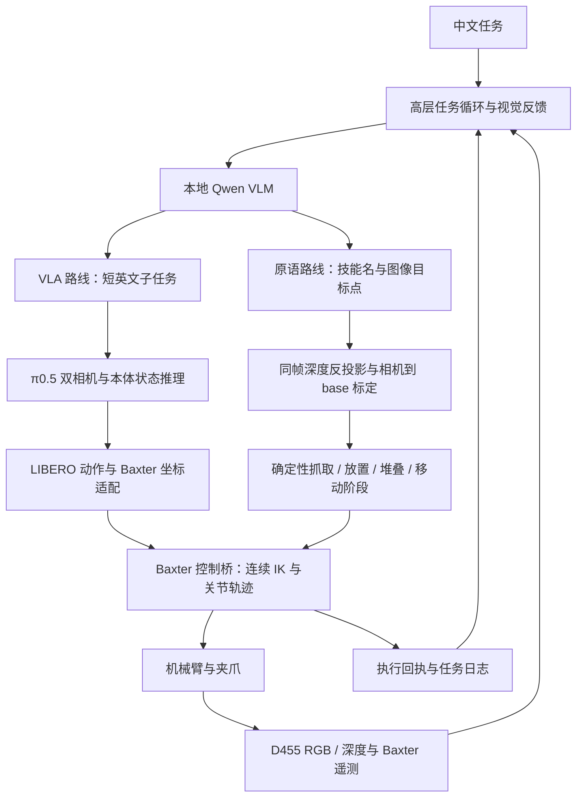

# 同芯致行 · TY1100 本地具身 Harness

## 2026-11-10 遮挡与抓空恢复

原语路线新增可恢复任务循环。模型用结构化 `reason` 区分遮挡、指代不明、找不到物体和不安全场景；不会通过匹配模型解释中的“遮挡”两个字触发运动。

| 情况 | 当前处理 |
| --- | --- |
| 机械臂遮挡目标或支撑面 | `clear_view`：先抬到通行高度，再移到配置的观察位，保持当前工具朝向与夹爪状态；完整 IK 预检通过才执行，随后重拍、重新选目标点 |
| 一个观察位仍遮挡 | 尝试另一个未使用的观察位；同一恢复阶段不反复去同一位置，不能让位时明确记录原因 |
| 目标点深度缺失或跨越深度边缘 | 返回 `target_depth`，重新取图，让 VLM 选择可见的内部点；不猜深度 |
| 观测过期、规划期间手臂被移动 | 丢弃旧观测与计划，取新图和遥测后重新规划 |
| 目标路径没有连续 IK 解 | 所有执行器尚未动作，返回具体错误供重新规划；模型/遥测不一致属于硬错误，不按普通不可达重试 |
| 闭爪后确认抓空 | 返回已执行阶段及 `empty_grasp`，停止当前抓取；新观测仍为空载时先让位/撤退，再看图重定位，默认最多重试一次 |
| 执行途中丢物、未到位、夹爪超时、停止失败或动作回执丢失 | 停止并留证；不自动重放物理命令 |
| 剩余阶段预算不足 | 在耗时 IK 之前给出预算不足，不做到一半才发现没有预算 |

恢复动作也占用机器人运动预算与 `--max-turns`；另有 `--max-recoveries`（默认 3）和 `--max-grasp-retries`（默认 1）。每次重新规划必须使用新的观测 ID；完整轨迹保留在日志中，给 VLM 的上下文只保留最近三条结果摘要。单独移动/让位不计作抓取完成。持物状态下的单独 `open` 被拒绝，应通过 `place/stack` 在支撑面释放。

**现场启用观察位：** 在 `primitives.observation_tcp_m` 中记录 1–4 个实测 base 坐标 TCP 位置，模板默认空列表。位置必须在已核验的工作区内、不低于 `transit_z_m`，并实际让目标区域露出。记录位置不会自动扩大工作区或声明标定完成；现有局部配置是否有足够的侧向让位空间，需要现场核验。它不是完整三维碰撞规划器，也不会自动移动另一只手臂。

可以在只读状态手动摆到合适的观察位，查看画面确认视野后，在有该本地配置和 9102 连接的机器上记录：

```bash
python3 -m cix_harness.record_view --config config/baxter-primitives.local.json
```

此工具只读遥测、计算并保存 TCP，不发机械臂/夹爪命令，不改 `commissioned/calibrated`。配置须放回控制主机，并在下一次正常启动桥时加载。随后仍先用不带 `--execute` 的任务入口预览完整 IK。预览模式遇到遮挡只生成让位计划，不实际移动。

该恢复版本完成离线故障注入回归；尚未进行新恢复流程的真机验收。下面的成功抓取记录属于此前的人工定位局部测试，不能用来证明新恢复流程已在硬件上通过。VLA 路线仍是独立入口，本次没有把原语恢复动作自动混入 π0.5 执行循环。

## 2026-11-10 现场原语抓取结果

此次抓取所用版本 `4d5edf8` 已部署到天数板子和 Baxter 主机，并恢复 Qwen3.5-9B-AWQ、SSH 隧道与只读相机控制桥。两端工程回归通过。修复了机器人与控制电脑的实测时钟偏差导致新遥测被误判为未来消息的问题：`robot_clock_offset_s` 表示机器人减主机的秒数，必须现场测量；默认 0，原有 0.5 秒时效、重复时间戳检查仍保留，不能拿它接受真正过期的数据。

**首次原语局部抓取成功：机器人自身左手（画面右边）抓起画面右侧青色方块。** 用户先手动将夹指对准物体顶面，建立该目标的局部参考，再抬高空载校准夹爪。随后程序完成完整 IK 预检、接近、下探、闭爪、夹持检查和抬升。闭爪与抬升后的夹持反馈均为 true；最终开度约 18.3%，图像可见青色方块在指尖，最终稳定末端相对闭爪位置抬高约 12.9 cm。结束后恢复只读并保持夹持，没有自动释放。

**范围说明：这不是完整自主视觉定位抓取。** 原语 VLM 在新图中识别到目标被机械臂遮挡并返回 blocked；实际执行使用用户确认的局部目标参考，不假称该动作由 VLM 成功定位触发。旧手眼外参在本次核验中推算桌面 z≈−0.047 m，与之前实测约 −0.18 m 明显不符，未直接用于下探。局部配置使用当前桌面法向、旧偏航参考和操作员目标点配准；TCP 轴向偏移根据此前贴桌记录估计，XY 偏移仍是假设。该配置只用于目标附近的小工作区，不是完整精确相机／工具标定。

本次现场修复还明确了左右语义：`arm=left` 永远是机器人自身左手；目标的左右必须明确标注“画面左／右”。原语提示要求模型不要把“尚未到物体上方”当作拒绝抓取的理由，因为接近与开爪由原语承担；真正遮挡或目标不确定时仍拒绝自动定位。证据仅存于本地 `examples/lab-20261110/` 与现场主机 `runs/site-20261110/`，不公开上传。

## 2026-11-10：双路线代码结构与动作原语使用说明

公开仓库只同步源码、配置模板、测试和说明；`examples/` 内的实验室照片、遥测、标定与运行记录保留在本地，不随 Git 发布。下文历史记录中的 `examples/` 链接是本地归档路径，在公开仓库中不可用。权重及供应商依赖也不存入 Git。工程测试命令及现场验证边界见上方更新。

当前仓库是 Baxter 的比赛工程：高层看图理解任务，低层可以选择 VLA 或确定性原语，两条路线共用控制基础设施。11 月 6 日的 VLA 真机记录在下文；原语已完成上述人工定位局部抓取，但完整视觉自主抓放、恢复与堆叠仍待真机验收。不要把软件测试通过解释为物理任务成功。

### 整体结构：模型决定做什么，控制桥负责怎样可靠执行



板子负责模型推理和任务调度，Baxter 控制电脑负责 ROS、相机和电机。它们通过 HTTP RPC 和 SSH 隧道连接。代码放在同一仓库，进程运行在不同机器；无需把 ROS 装进天数模型容器。VLM 低频决定下一步；电机轨迹由控制电脑持续发送，不会每个关节周期都请求 VLM。

| 文件或目录 | 实际职责 | 为什么单独分开 |
| --- | --- | --- |
| `cix_harness/__main__.py` | 原 VLA 任务 CLI、模型检查、任务循环、Journal 日志 | 保存原来已经上板的入口 |
| `planner.py` | 把中文目标、当前图像、实测夹爪状态与近期执行结果发给 Qwen，检查 JSON 决策 | 不直接调用电机；不能把模型文字当执行事实 |
| `rollout.py` | 为 VLA 重新取图、预测有限动作、核验回执，不重放通信异常后的动作 | 模型推理与机器人执行之间的编排层 |
| `pi05.py` | 加载真实 LeRobot π0.5、前后处理、推理、保存原始动作 | 权重加载与 COREX 的实现细节不进入机器人 SDK |
| `pi05_contract.py` | 本体状态变换、七维动作单位与姿态表示转换 | LIBERO 的约定不同于 Baxter；此前反向漂移仍待适配验证 |
| `vla.py` | 早期 OpenVLA 服务 | 保留候选路线，不是当前 π0.5 实机主入口 |
| `segments.py` | 将模型预测前缀组合成有限运动段 | 避免每个微小预测都停走；这种时间适配仍有迁移局限 |
| `primitive_runner.py`（新增） | 独立 VLM+原语任务循环，输出白名单技能与二维目标点 | 完全不调用 VLA 服务，能单独推进 |
| `primitives.py`（新增） | 几何配置校验、TCP 变换、RGB-D 定位、确定性技能阶段生成 | 纯规划部分可脱离 ROS 测试 |
| `primitive_service.py`（新增） | 原语观测、全路径 IK 预检、一次性计划执行、阶段回执 | 机器人侧管理状态与执行权限，不接受模型生成代码 |
| `baxter.py` | ROS 状态、Baxter SDK、连续轨迹、工作空间、时效与异常处理 | 两条路线共享硬件层；原语配置下不开放 VLA 运动 RPC |
| `kinematics.py`、`upstream/kdl_parser.py` | 读取 URDF、连续种子 IK、关节限位和正解核对 | 不等于完整碰撞规划器 |
| `camera.py` | 同帧对齐 D455 RGB-D、相机时效、记录深度 | 原语使用深度几何；VLA 主要使用图像 |
| `task_monitor.py`、`task_guard.py` | 原 VLA 抓持/抬升证据与接触边界 | 原语另有明确阶段后置条件，不把两个成功判据混用 |
| `rpc.py`、`contract.py` | 回环 HTTP、请求响应封装、数据格式校验 | 控制与模型环境隔离 |
| `coordinate_audit.py` | 离线检查 VLA 坐标与动作日志 | 诊断工具，不修正或放行运动 |
| `integrations/rpent/` | RPent 原生 Baxter 扩展与只读验证入口 | 独立于默认任务 CLI；不声称完整 RPent 主运行时已真机验证 |
| `config/`、`deploy/`、`tests/`、`third_party/` | 配置模板、部署脚本、工程回归、来源与许可证 | 权重、密钥、真实现场配置不进入 Git |

### HarnessVLA、RPent 与我们到底是什么关系

HarnessVLA 不是“仅有一个 VLA、不存在高层规划”。其[项目材料](https://github.com/harnessvla/harnessvla.github.io/blob/main/our_paper)描述的是高层 agent、冻结 VLA、固定解析原语和记忆的组合：VLA 专注局部接触，解析原语完成接近、搬运、释放等连接阶段，高层负责目标绑定、调度与恢复。这和通常所说“VLM 发一句子任务、VLA 包办后续运动”有明显区别。

我们的直接代码来源是固定版本 **RPent** 的 RPC 和有界 `vla_grasp` 执行循环，以及 LeRobot/OpenPI 模型实现；不是复制一套名为 HarnessVLA 的工程再做机械替换。`third_party/README.md` 逐文件说明了来源。若先前说“参考 HarnessVLA 实现”让人理解为完整复现了它的解析原语、任务记忆和全局记忆，这是不准确的。已有 `runs/` 是执行记录，不是自动检索、总结并复用的任务记忆系统。

| 对比 | HarnessVLA 的方法 | 11 月 6 日我们的 VLA 路线 | 本次新增原语路线 |
| --- | --- | --- | --- |
| 高层 | Agent 做目标绑定与技能组合 | 本地 Qwen 输出短英文子任务 | 本地 Qwen 输出技能名和目标点 |
| 低层 | 冻结 VLA 局部接触 + 解析原语 | 主要由 π0.5 输出整段动作 | 手写参数化阶段与 IK，不用 VLA |
| 几何 | RGB-D 重新绑定目标与准备接触状态 | 图像和试配本体坐标输入策略 | RGB-D、camera→base、TCP、绝对目标 |
| 恢复 | 记忆引导的重定位、调整和再尝试 | 重新观察与有界重调度；无完整经验记忆 | 遮挡让位、抓空撤离重定位、可恢复预检重规划；不明执行状态不重放 |
| 当前边界 | 方法与其具体实验设置有关 | 已真机运动，抓取未成功 | 人工定位局部抓取成功；新恢复流程待真机验收 |

现在两条路线是明确选择的两个入口，还没有实现同一轮中自动决定“这一段走原语、下一段走 VLA”的混合调度。共享控制桥为以后混合调度留下接口，但不能把这个未来能力说成现在已有。

### 动作原语的实际行为

- `pick`：先升高 → 在高处调整工具朝向 → 移到目标上方 → 开爪 → 下探 → 闭爪 → 检查夹持 → 抬升 → 再检查夹持。
- `place` / `stack`：需要已经夹持；先升高 → 搬运到支撑面上方 → 下探到放置高度 → 开爪并检查释放 → 撤离。堆叠的目标点是底层方块的顶面。
- `move_to`：经配置的高处通道移动到指定 TCP 点，不自动开闭夹爪。
- `lift` / `retreat`：保持当前朝向，沿 base 的 Z 抬升配置距离。
- `open` / `close`：只操作夹爪；单独 `close` 不代表抓取成功。
- `home`：空载时经高处通道移动到人工配置的工作待机点；不是系统零位、不是任意关节复位。
- `clear_view`：通过配置观察位让出相机视野；保持姿态与夹持，随后重新拍照定位。

当前一个控制桥绑定一只手臂，`arm=left/right` 可选；没有新增双臂协同、交接、铰链操作或完整三维避障。它覆盖本项目当前的单臂桌面抓取、搬运、放置与方块堆叠目标。更复杂原语需要独立建模，不能因旧毕设仓库有这些功能就宣称本项目已移植。

原语以 **TCP（实际抓取参考点）** 为目标。相机点先由 D455 同帧深度和内参反投影，再通过实测外参转换到 base；控制前根据工具姿态把 TCP 换成 SDK 末端点。`grasp_inset_m` 指从物体顶面向下进入夹持位置的距离；放置高度由支撑面、物体底部相对 TCP 的偏移和释放余量组成。单个固定物体尺寸配置适用于演示物体，不能直接推广到任意尺寸物体。

参考毕设的 `bridge/primitives.py` 和 `bridge/drivers/baxter_driver.py` 的阶段顺序与 SDK 语义，保留 MIT 来源说明。没有照搬连接时自动夹爪校准、固定 `z=-0.16` 或仅以命令返回值判抓取成功的做法。现有控制桥仍使用 `Limb.endpoint_pose/joint_angles/set_joint_positions`、`Gripper.command_position/gripping/position`。

### 部署与验证流程

1. 两台机器从本仓库获取同一提交。现有 VLA 服务无需改权重；只运行原语路线时不需要启动 π0.5。先停止原控制桥，避免两个进程同时占用 D455 或控制同一只手臂。
2. 在控制电脑复制 `config/baxter-primitives.example.json` 为 `config/baxter-primitives.local.json`。模板故意不提供有效的真实 EEF 工作区；填入实测 `workspace_min_m/max_m`。还必须测量 `primitives.camera_to_base_*`、`tcp_offset_tool_m`、工具朝向、TCP 工作区、桌面与通道高度、物体抓持深度和放置底部偏移。不要沿用已知有位移的旧标定作为精确值。
3. ROS 环境保持原部署方式（先 source Noetic 与 Baxter 工作区，再设置 ROS master 和本机 ROS_IP）。先不带 `--arm-motion` 启动控制桥。
4. 板子通过已有 9102 隧道访问控制桥，用下列入口做只读 VLM 决策、深度定位与全技能 IK 预览。RPC `primitive.prepare` 只生成一次性计划，不动电机。相机标定未验证时的预览不能当成可信抓取目标。

```bash
# Baxter 控制电脑：默认只读
python3 -m cix_harness.baxter --config config/baxter-primitives.local.json

# 板子：仅需 VLM 9110 和机器人隧道 9102
python3 -m cix_harness.primitive_runner --task '抓起青色小方块' --task-kind pick

# 原来的 VLA 路线仍是独立入口；需要切回对应控制桥配置和 π0.5 服务
python3 -m cix_harness --vlm-port 9110 --vlm-model qwen35-9b run \
  --task '抓起青色小方块' --execution-mode segment --task-kind pick
```

5. 现场验证配置后才设置顶层 `commissioned=true` 和 `primitives.calibrated=true`，控制桥启动时加 `--arm-motion`；任务入口另加 `--execute`。代码不自动使能机器人，也不自动校准夹爪。先预览、后执行需要重新获取观测，不能重放前一次预览的旧计划。
6. 抓取、放置分别验证后再运行 `--task '把青色方块叠到黄色方块上' --task-kind stack --execute`。每个技能结束重新取图，VLM 和夹持反馈共同判定任务结束。实际叠放稳定性仍需现场看结果。

每次原语运行写入 `runs/<时间-ID>/`，包含图片、模型决策、三维目标、计划阶段、执行回执；控制桥另记录每个执行阶段和部分失败。读取原语观测会使旧计划失效；计划执行一次即消费，即使超时也不能重复执行。全路径 IK 失败时不执行任何阶段；抓空时不继续抬升，未到放置点时不释放。保留 1 cm 到位判据，不要求 2–3 mm；该判据用于决定能否进入接触/释放，不是宣称硬件全域精度。

工程验证：`python -m unittest discover -s tests -v`。新增测试覆盖抓取阶段、堆叠高度、TCP 偏移、空抓、未到位禁止释放、只读模式、过期/重复计划、任务循环和丢失回执不重放。这些测试不用机器人、不会访问天数板。

---


## 2026-11-06 反向移动排查：执行方向一致，策略适配尚未成立

本轮保持两端只读，未发送机械臂或夹爪命令。已核对上一轮 4 次预测的完整原始轨迹、状态与 3 段执行回执，并完成 8 次历史观测重推理。**没有找到“控制器将平移符号执行反了”的证据；也没有证明当前跨本体坐标映射正确，不能用简单 Y 轴取反冒充修复。**

- 最长运动段：计划 base 位移 `[-1.678,+8.271,-4.069] cm`，实测 `[-1.774,+8.827,-3.858] cm`，方向夹角约 `2.54°`。原始 π0.5 输出已经含正 Y；反归一化后的动作到桥接动作的逐项重算误差为 0，观测到 state8 的重算误差也为 0。数学一致性不等于相机和本体适配正确。
- 任务试配使用 `policy_from_base=identity`，位置平移 `[-0.860253,-0.115068,+0.787334] m`，工具局部 Z 旋转 180°。这些是此前实验性虚拟工作区参数，不是完成标定的相机／机器人变换。贴桌单个参考点不足以确定完整三维坐标关系或长夹指 TCP。
- 长轨迹第 1 至第 4 次预测的虚拟 Y 从 `0.350` 增至 `0.488 m`；检查点状态统计的 Y 的 1%–99% 区间为 `[-0.136,0.222] m`，最大值约 `0.391 m`。后两次已越过该统计最大值。归一化加离散化后，四次 Y 都编码为 `255`；旋转向量 Y 也都为 `255`。这表明部分状态信息饱和，但不能单凭统计区间推导正确坐标或证明唯一故障原因。没有对实测状态做钳位、没有改检查点归一化。
- 在历史 `001-vla.jpg` 上固定输入和噪声重复推理，返回 16 行动作完全一致；换三个种子后的首动作 Y 分别为 `+6.31,+0.73,-1.65 mm`。在末次 `005-vla.jpg` 上分别为 `+14.73,-5.66,-1.81 mm`。随机性会影响方向，不能挑一次“看起来正确”的预测作为映射正确的证据。重放仅用于工程定位，不是成功率评测。
- 已核对 [robosuite 控制实现](https://github.com/ARISE-Initiative/robosuite/blob/v1.4.1/robosuite/utils/control_utils.py)：平移增量直接加在世界坐标的当前末端位置，姿态增量左乘。当前软件约定与之相符。[固定 LeRobot 版本的 LIBERO 处理器](https://github.com/huggingface/lerobot/blob/8fff0fde7c79f23a93d845d1a50e985de01f8b8a/src/lerobot/processor/env_processor.py)对模拟器图像旋转 180°以匹配数据集；这不能直接推出真实 D455／腕部图像也应翻转。两路真实图像、工具坐标和模型训练视角仍需一并核对。

新增 `cix_harness.coordinate_audit` 离线审计工具、固定噪声只读推理及图像哈希／归一化状态日志；任务日志现在关联完整原始策略 trace。`deploy/replay_pi05_readonly.py` 仅调用健康检查和推理接口，使用未放行的历史配置，退出时恢复原配置。**48 项工程回归通过；这不代表反向预测或真实抓取问题已修复。**

证据：[完整坐标审计](examples/lab-20261106/coordinate-audit/long09-audit.json)、[8 次只读重推理](examples/lab-20261106/coordinate-audit/readonly-replays.json)，同目录保存完整原始策略输出。离线复核：

```bash
python3 -m cix_harness.coordinate_audit \
  --run examples/lab-20261106/long-grasp-09 \
  --traces examples/lab-20261106/coordinate-audit \
  --normalizer models/pi05-libero/policy_preprocessor_step_2_normalizer_processor.safetensors \
  --output coordinate-audit.json
```

后续先实测 D455→base、腕相机→工具以及实际抓取 TCP，再把真实目标相对末端的方向与模型动作投影对应起来；基于同一固定观测核对修改前后方向。策略状态必须和动作使用互逆、一致的坐标变换，不能只反转输出的一个轴。LIBERO→Baxter 的视角、机械结构和控制时序差异仍可能需要模型适配／真机数据；完成几何标定也不保证零样本抓取成功。

## 2026-11-06 实机部署状态

当前 Windows 电脑已可用 `ssh ty1100` 登录板子（`cix@192.168.1.103`），用 `ssh baxter-control` 登录控制主机（`cothink@192.168.1.101`）。控制主机指纹已在物理终端核实。Baxter 本体为 `192.168.1.100`，ROS master 在本体的 11311 端口。两台主机的项目目录均为 `~/cix-harness-lab-20261106`。

已实测：MR-V100X 显存 **32768 MiB**、COREX 4.4.0，主存约 15 GiB。板子实际使用 **sudo nerdctl/containerd**，Docker daemon 未运行；内核不支持默认容器 bridge，必须使用 `--network host`。复用缓存的厂商 ARM64 镜像，**Qwen3.5-9B-AWQ 与 π0.5-LIBERO 已同时运行并完成真实双相机推理**，GPU 总占用约 **23448 MiB / 32768 MiB**。VLM 在 `127.0.0.1:9110`（模型 ID `qwen35-9b`），VLA 在 `127.0.0.1:9101`。无需再下载早期轻量模型来验证这张卡。

当前 π0.5 使用官方 `lerobot/pi05-libero`，固定检查点 `9ba5431256f4136a01c224ab0307b0d3035cc92c`；完整权重已校验，813 个张量逐一检查名称和形状、分张量加载到 COREX。运行依赖为 LeRobot v0.4.4 及 OpenPI 兼容 Transformers 分支，均独立挂载，保留厂商 Torch。真实输入包括 D455、Baxter 左腕相机、末端位姿与夹爪状态。首次前向约 4.7 秒，预热后约 1.0–1.1 秒；VLM 与 VLA 的完整只读规划/逆解链约 8–10 秒。这是具体检查点和输入下的测量，不代表抓取能力已验证。

### 最新：双臂重新摆位后的长轨迹抓取重试

操作员重新摆放双臂后，从新遥测与双相机图开始运行左臂完整抓取闭环，未复用旧预测。左末端初始约 `[0.8125, 0.4389, 0.2259]` m，右末端约 `[0.8312, -0.4199, 0.1225]` m；右臂没有收到本轮运动命令。外部视角恢复无遮挡后，VLM 规划使用 D455，目标选为画面中靠左的蓝绿色方块。模型和相机/本体坐标适配未重新训练。

首次 [long-grasp-08](examples/lab-20261106/long-grasp-08/events.jsonl) 在运动中因侧向工作区边界停止；没有完整成功回执，但机器人审计证实已移动约 **3.27 cm**，不能当作未执行。其目标距离旧侧向边界太近，随后扩大高处工作范围，并把局部桌面参考的水平半径限制仅应用于估计工具距接触下界不足 10 cm 的区域；近桌接触边界、关节和遥测检查仍保留。

重新取图后的 [long-grasp-09](examples/lab-20261106/long-grasp-09/events.jsonl) 完成三段连续运动：

| 段 | 实际起终点距离 | 执行耗时 | 终点位置误差 |
| --- | --- | --- | --- |
| 1 | 2.95 cm | 2.46 s | 6.60 mm |
| 2 | 9.80 cm | 4.81 s | 6.02 mm |
| 3 | 5.38 cm | 10.28 s | 4.47 mm |

三段起终点距离相加 **18.12 cm**，这是分段净位移之和，不是高频采样的完整轨迹弧长。末端 y 从用户摆位时约 0.439 m 持续增加至约 0.60 m，下一段仍预测向外，因超出扩大后的工作区在发送该段前停止。整轮约 43.4 秒，**没有抓起方块，夹持反馈始终为 false**。没有为了继续运行而再扩展侧向范围。最终[外部画面](examples/lab-20261106/long-grasp-09/long-final.jpg)、[腕部画面](examples/lab-20261106/long-grasp-09/long-final-wrist.jpg)、[遥测](examples/lab-20261106/long-grasp-09/long-final-state.json)及[电机审计](examples/lab-20261106/long-grasp-09/long-grasp-09-motion.jsonl)已保存；控制桥与策略均恢复只读，模型保持加载。

本轮允许最多 12 轮高层调度、64 行模型动作预算、最长 12 cm 的单段，不代表强制把每段放大到该幅度。预算剩余量现会限制下一次预测长度，并在用尽后保留最后一次视觉检查，避免临近预算时超发。最新工程回归为 **45 项**。长段执行已经有实测记录，目标接近仍未成功；需继续检查当前策略的坐标、视角与跨本体动作适配，不能仅凭放宽精度或工作区解决。

### 连续厘米级动作与抓取重试（19:37–19:45）

按操作员要求删除固定 `0.08 rad / 4.58°` 倾斜停机条件，加入连续运动段执行。**已产生 5.62 cm、5.56 cm 等模型驱动的实际运动及多次开闭爪，仍未抓住并抬起目标。** 最后一轮完整运行约 53.2 秒，按四轮高层调度预算结束，未再触发先前的固定倾角或接近缓冲误停。结束后控制桥 `armed=false`、策略 `motion_ready=false`，模型仍保持加载。

| 真实任务尝试 | 有回执的各段实际净位移 | 结束原因与结果 |
| --- | --- | --- |
| [segment-grasp-05](examples/lab-20261106/segment-grasp-05/events.jsonl) | 5.62、1.89 cm | 闭爪后误差 10.8 mm，旧 10 mm 验收逻辑退出；夹持反馈均为 false |
| [segment-grasp-06](examples/lab-20261106/segment-grasp-06/events.jsonl) | 1.24、1.78、0.98 cm | 后续一段执行中侵入计划接近缓冲约 0.1 mm，旧缓冲判据退出；不能把失败段算作未执行 |
| [segment-grasp-07](examples/lab-20261106/segment-grasp-07/events.jsonl) | 1.30、1.46、3.13、5.56 cm | 四轮预算结束，全部回执正常；夹持反馈始终 false，无抓取成功 |

这些数字是每段起终点的实测距离，不是完整轨迹长度。12 cm 是单段允许上限，不是本次已实现的最大位移。最新[电机审计](examples/lab-20261106/segment-grasp-07/segment-grasp-07-motion.jsonl)、[最终腕部图](examples/lab-20261106/segment-grasp-07/segment-final-wrist.jpg)和[最终遥测](examples/lab-20261106/segment-grasp-07/segment-final-state.json)可核对：末端仍未可靠对准青色目标，夹爪约 4.34% 开度、夹持 false。

当前执行逻辑：

- `--execution-mode segment --action-window 16` 取得最多 16 行真实预测；累计平移并按顺序合成旋转，在方向反转、12 cm 预测路径预算或夹爪开闭转变处分段，不直接倍乘单个动作。闭爪发生在模型预测的段末。
- 用连续 KDL 生成中间关节节点，再连续发送轨迹；内部节点不逐个等待到位。只在段末检查跟踪质量。完整预测不可达时保留可达的预测前缀，重新取图后继续，不强行跳 IK 解。
- 段末未满足 1 cm 位置或 0.04 rad 姿态验收时，记录误差并交回视觉纠偏，不再因此终止整个任务。关节跟踪异常、关节限位、工作区、遥测失效及估计的桌面接触边界仍会停止运动。
- 删除独立倾角硬阈值；保留由贴桌参考姿态和工具范围估计得到的高度约束。规划目标包含 5 mm 接近余量，并额外留出投影余量；运动中判断估计接触边界，不把计划缓冲当作实际碰桌线。原始预测下探过深时调整计划高度，日志同时保留合成动作和实际目标位置。
- VLM 可用腕部画面规划，VLA 仍接收真实双视角。对夹爪开度增加明确文字状态，修复 VLM 将 4.34% 描述为打开的歧义；只读实测已正确返回“nearly closed、not holding”。见[修复后规划](examples/lab-20261106/segment-grasp-07/segment-final-plan.json)。

**实现边界：**这是针对 Baxter 的受约束动作段适配，合并和时间缩放改变了原始 LIBERO 控制时序；桌面高度余量仍使用暂定 0.2 m 工具范围，尚未获得长夹指精确几何。坐标、相机视角及动作适配仍需解决，不能把当前抓空单独归因于模型能力，也不能声称跨本体迁移已经成功。以下更早记录中的固定倾角阈值和逐微小路点验收已被本节方案替代。

在现场完成配置并明确放行后，任务入口为：

```bash
python3 -m cix_harness --vlm-port 9110 --vlm-model qwen35-9b run \
  --task '抓起青色小方块并抬离桌面，保持夹持' \
  --execution-mode segment --action-window 16 --steps 16 --max-turns 4 \
  --planner-view wrist --task-kind pick --execute
```

缺省配置仍未放行，命令不会自行使能机器人。只读连续 IK 接口是 `env.preview_segment`，实际执行接口是 `env.step_segment`。最新工程回归为 44 项，包含动作合成、夹爪转变、反向分段、接近缓冲、视觉纠偏及不重放未知执行结果；实机抓取结果以本节记录为准。

真机记录：π0.5 的新图预测已产生实际动作和回执；另做了明确标注为非模型预测的控制诊断。5 cm 上移实测 5.07 cm、终点误差约 2.1 mm；15 cm 上移分五段完成，实测总位移 14.86 cm、终点误差约 4.9 mm、总耗时约 12.9 秒。见 [π0.5 真机回执](examples/lab-20261106/pi05-live-step/events.jsonl)、[5 cm 诊断](examples/lab-20261106/five-cm-success/events.jsonl)、[15 cm 诊断](examples/lab-20261106/fifteen-cm-success/events.jsonl)。**这些不是抓取成功记录，也不是长期精度保证。**

联调修复包括：左电动夹爪行程校准；执行前只读预热以避免首次推理使观测过期；使用当前关节角初始化 KDL 连续逆解，避免 Baxter 服务偶发换解；低速五次多项式轨迹；机器人端动作预算、累计位移边界及动作审计。Python 3 KDL 解析器只移植在项目内，不改系统安装。工程诊断以位置误差 1 cm、姿态误差 0.02 rad 验收到位，仍保留每段关节变化 0.15 rad、观测时效和异常停止检查。`applied` 表示命令已执行，`target_reached` 单独记录实际是否到位。5 cm 以上诊断使用独立的 `supervised_cartesian_diagnostic` 模式，最多五段、总半径不超过 20 cm，并禁止直接运行模型策略循环；本次实际设为 18 cm。所有诊断结束后都恢复只读。

控制主机的 D455（序列号 `241122306976`）已返回 640×480 实拍图；只读桥在 `127.0.0.1:9102`，真实左臂位置与夹爪遥测可读。板端已有专用 SSH 隧道直连这个端口，数据不经过 Windows。机器人时钟比控制电脑快约 30 ms；桥允许最多 100 ms 的未来时间偏差，将有效年龄钳制到零，并拒绝重复/倒退时间戳，仍保留 500 ms 遥测失效检查。

中文任务“拿起桌面中央的蓝绿色小方块”已完成实时看图规划：约 **7.625 秒**返回 `act / pick up the blue-green cube`，正确描述方块位置及闭合的空夹爪。现场结果见 [图像与规划日志](examples/lab-20261106/live-plan/events.jsonl)。早期请求发生过可见目标被误判 `blocked` 的问题，已明确状态单位、JSON 字段和枚举，并要求先陈述证据再决策；一次正确结果不代表任务成功率已经验证。首次不同输入触发算子编译的请求约 110 秒，不能与预热后的单次延时混用。

**尚未完成：完整 RPent 主循环实机验证、精确工作区/策略坐标标定、真实抓取。** π0.5-LIBERO 的 Panda 状态以虚拟指宽映射适配 Baxter；已试过局部虚拟工作区映射，尚未证明跨机器人迁移成功。旧 D455 手眼标定只作参考，不能用它直接给抓取目标下精确坐标。默认机器人和模型配置均未放行任务运动。

### 18:11 首轮真实抓取任务与后续修复

**18:59 人工摆位后的局部抓取结果：未抓住、未抬升。** 用户将青色方块放在左夹爪两指之间，腕部图像确认摆位。新增 `--planner-view wrist`，仅将高层规划图切到腕部，π0.5 继续使用 D455 与腕部双视角。VLM 用约 7.4 秒识别目标并发出 `pick up the cyan cube`；π0.5 用约 1.08 秒预测。第一条动作按原有 1 cm 工程容差返回到位，实际末端位移 3.85 mm、目标误差 8.97 mm；第二条在执行途中触发贴桌姿态倾斜限制，窗口停止。不能把这条第一步回执视为小幅抓取控制精度已经合格。最终夹爪 100% 打开、夹持反馈为 false，机器人和策略均恢复只读。

见[局部抓取任务日志](examples/lab-20261106/placed-cube-trial-04/events.jsonl)、[逐步电机审计](examples/lab-20261106/placed-cube-trial-04/placed-cube-trial-04-motion.jsonl)、[最终腕部画面](examples/lab-20261106/placed-cube-trial-04/placed-cube-final-wrist.jpg)。这一轮没有强制闭爪，没有用固定抬升动作代替模型预测，也未降低桌面下界。尚需解决小动作跟踪与姿态变化，才能实际验证闭爪和抬升阶段。

此前两次启动尝试分别因 D455 USB 传输错误、桥重启时设备占用而停止，均没有发出机器人动作。已定向重置该 D455 并验证连续新帧；控制桥新增相机首帧就绪检查和 SIGTERM 退出清理，现场启动脚本改为等待旧进程真正退出，再创建新桥。后一次模式切换和退出恢复已成功。现在共有 37 项本地模拟回归测试，包括腕部图像缺失时禁止执行。

中文目标为“抓起桌面中央的青色小方块并抬离桌面，保持夹持”。Qwen3.5 产生英文子任务，π0.5 按新图预测，控制桥执行了 **9 个真实模型动作**。第 10 个候选动作在发往电机前被桌面约束拒绝：目标末端 z=-0.1534 m，按当时工具姿态计算的接近下界为 -0.1495 m。约 48.2 秒后退出并恢复只读，夹爪仍全开、`gripping=false`，**没有抓取成功，也没有执行堆叠**。

[完整任务日志](examples/lab-20261106/task-trial-01/events.jsonl)、[机器人审计](examples/lab-20261106/task-trial-01/grasp-task-trial-01-motion.jsonl)与[停止时腕部画面](examples/lab-20261106/task-trial-01/009-vla-wrist.jpg)已归档。腕部画面中青色物体仍在夹指外侧，因此失败不能仅归因于下探限制。此次试验的配置文件只用于解释历史记录，不应直接当作当前场景的放行配置。

| 工作 | 已实现及证据 | 尚未验证的范围 |
| --- | --- | --- |
| 统一执行控制器 | 任务与诊断都走连续 KDL、五次多项式关节轨迹、实际到位检查；首轮任务使用该路径 | 不是完整避障规划，较大运动仍须逐段可达性检查 |
| 有界动作窗口 | 每张新图执行 1–4 个候选动作；本轮用 2，保留原图时间戳、动作预算及有效期；模型常驻，策略配置可热加载 | 目前是依次到位的短路点窗口，不是 LIBERO 的 20 Hz 原始控制时序；时间缩放的迁移效果待验证 |
| 坐标与接近边界 | 双侧指尖贴桌位姿、对齐深度快照已保存；修正 LIBERO 轴角跨 π 时被错误翻转的问题；增加局部接触参考约束 | 虚拟工作区原点为试验映射，长夹指几何和精确手眼标定未完成，不能声称坐标适配已经验收 |
| 任务完成判断 | `pick` 要求真实夹持反馈并抬升至少 2.5 cm；`place/stack` 还要求已执行释放，再由 VLM 看最终排列；新增意外掉落停止与重新抓取清除旧证据 | 这些是程序判据，真实抓取/摆放/堆叠均尚未通过；堆叠仍依赖视觉判断，没有几何精度保证 |

后续修复已经同步到两机：窗口因图像即将过期而截短时，直接取新图继续 VLA，避免不必要的 VLM 调度；夹爪状态转变仍触发重新观察。原始失败运行中有 4 轮 VLM，每轮约 8–10 秒，这是主要等待来源；每个 π0.5 窗口推理约 1.1 秒，实际运动窗口约 0.76–1.95 秒。新调度的性能提升尚未通过另一轮真实运动测量。36 项本地回归测试通过，包括不重放动作、预算、到位失败、图像时效、桌面约束和掉落处理。

操作员轻触桌面时记录的左侧末端均值为 `[0.810253, 0.115068, -0.167334]` m，右侧为 `[0.862447, -0.254738, -0.164513]` m，均在 base 系中。它们是各自工具与姿态下的末端接触参考，**不是指尖坐标，也不是统一桌面高度**。详见[左侧测量](examples/lab-20261106/task-trial-01/table-touch.json)、[右侧测量](examples/lab-20261106/task-trial-01/table-touch-right.json)。单一贴桌姿态与近似桌高不能唯一确定长夹指三维偏移。

局部约束用接触参考、8 mm 接近余量和暂定 0.2 m 工具半径上界处理姿态变化；这个尺寸是保守假设，尚不是实测 CAD。修复后的高度余量计算包含倾斜夹具的局部偏航影响。它假设局部桌面平坦，不能替代真实夹指几何、桌面倾斜测量或障碍物检查。实际抓取前需要解决对准问题，不能为让某个预测通过而直接降低下界。

已校验的 `supervised_policy_task` 机器人配置要求接触约束、连续 KDL、1–64 个动作预算和最多 600 秒有效期。高层入口支持 `run --action-window 2 --task-kind pick --steps 4 --max-turns 6`；只有两侧配置及控制桥均明确放行时才能加 `--execute`。缺省仍保持只读。下一轮人工摆位后的局部抓取如成功，应单独记录，不能冒充完整自主找物成功。

当前板子上的双模型只读入口如下。`run` 未加 `--execute`，不会发送动作。重启 VLA 后先执行一次 `predict` 预热，丢弃该预测，再用新图做后续检查。

```bash
cd ~/cix-harness-lab-20261106
sudo bash deploy/pi05-container.sh status
python3 -m cix_harness predict --robot-camera --subtask 'pick up the blue-green cube'
python3 -m cix_harness --vlm-port 9110 --vlm-model qwen35-9b run --task '拿起桌面中央的蓝绿色小方块'
```

VLA 退出后以 `sudo bash deploy/pi05-container.sh start` 恢复。板端 `models/pi05-libero` 是完整检查点，`vendor/lerobot`、`vendor/transformers-pi`、`vendor/pi05-python` 是已安装的兼容运行依赖。部署包包含固定源码归档、校验清单、依赖列表及服务脚本；不包含 9.35 GB 的 π0.5 权重或全部现场镜像，移到另一块板子仍需准备这些文件。`deploy/fetch_pi05.py` 使用 `deploy/pi05-manifest.json` 固定版本并校验下载；不要把只有元数据的本地目录当成完整权重。

在当前 Windows 电脑执行 `ssh ty1100`，随后可直接运行：

```bash
cd ~/cix-harness-lab-20261106
python3 -m cix_harness --vlm-port 9110 --vlm-model qwen35-9b plan --robot-camera --task '拿起桌面中央的蓝绿色小方块'
```

这条命令只读取一帧图像/状态并输出计划，将证据保存到 `runs/`，不调用 VLA 或电机接口。当前服务在后台运行，重新连接 SSH 不需要重复启动。下列命令仅用于服务退出或机器重启后的恢复，在各自终端保持运行：

```bash
# Baxter 控制主机：恢复只读桥（已有实例时不要重复执行）
cd ~/cix-harness-lab-20261106
export ROS_MASTER_URI=http://192.168.1.100:11311 ROS_IP=192.168.1.101
bash deploy/baxter-preview.sh

# 板子：恢复专用 SSH 隧道（已有实例时端口占用会使新实例退出）
cd ~/cix-harness-lab-20261106
bash deploy/robot-tunnel.sh
```

板上的模型容器可用 `sudo nerdctl start cix-harness-qwen35-awq` 恢复已有实例，用 `sudo bash deploy/vendor-vlm.sh status` 检查。仅在容器不存在时使用 `sudo bash deploy/vendor-vlm.sh start`；`stop` 会删除本项目实例。脚本使用现有权重及镜像，并预加载 ARM 镜像内的 OpenMP 库以修复 `cannot allocate memory in static TLS block`。容器启动后仍需等待模型就绪；首轮图像推理可能触发编译。

## 历史首装方案（当前板子优先使用上方 π0.5 路径）

携带 `ty1100-harness-lab.tar.gz` 和之前已校验的 `models/`。部署包内是可构建的项目源码、模型服务、ARM 运行依赖、Baxter 控制桥、历史图像和联调说明。系统需要板上已有可用的 COREX 驱动、容器工具，控制电脑已有 ROS Noetic 与 Baxter SDK。首装还要有基础镜像、软件源或相应缓存；双模型在工作站用真实权重做过文件预览，板上与硬件的首次联调在现场进行。

1. **先同时准备板子和机器人。** 板上记录 `ixsmi`、`free -h`、`df -h .`、`docker image ls` 和 `docker ps`。向现场工程师确认权重挂载点、ARM64 镜像标签和可直接调用的推理服务。另一台控制电脑同步接好 D455、检查 ROS、启动下文的只读桥。预期 32 GB 显存以读数为准。
2. **优先使用已有厂商模型。** 手册 §5.4.3 有 ARM64 Qwen3.5 多模态镜像和需要传入模型目录的启动命令；§5.4.6 以 VLA 镜像中的 `/root/README.md` 为准。先复用本机、移动硬盘或实验室共享目录中的权重，只补缺失的文件。用实际图片走模型端点；能聊天或显示容器运行仅说明服务已启动。优先问清 π0.5 的确切标签、检查点、真实图像与状态输入、动作单位与坐标、能否更换权重。
3. **选当天能闭环的组合。** 厂商强 VLM 已有兼容图像与 JSON Schema 的本地 Chat Completions 服务时，先用下方命令接它，OpenVLA 由项目的厂商派生镜像提供。若强 VLM 仍缺权重或接口不兼容，改用原双模型 `prepare/start`。若 π0.5 只有离线脚本或预录张量，保留厂商前向结果，将动作适配另行开发。当日真机继续使用已接入的策略。暂不将未经解释的动作块发送给 Baxter。
4. **从真图走到真动作。** 文件预览成功后，去掉 `--image` 看 D455 新图、目标指代和动作；现场测量工作区和策略坐标轴后，先用只读桥查看 `ik_preview`。使能、标定和在场急停准备好后仅放行一个受限动作，检查移动方向、实际位移和夹爪开闭。通过后才增加动作预算尝试抓取。动作回执表示命令已经送达；抓取成功要在当前画面与夹爪状态中确认。分别保存达到的阶段及对应日志。

假设厂商 VLM 在板子的回环端口 9110，先查询模型 ID，再替换示例中的 `actual-model-id`。从解压后的项目目录执行：

```bash
curl -fsS http://127.0.0.1:9110/v1/models
python3 -m cix_harness --vlm-port 9110 --vlm-model actual-model-id plan --image examples/baxter-d455.jpg --task '拿起桌面上的红色长条'
bash deploy/board.sh prepare-vla
bash deploy/board.sh start-vla
python3 -m cix_harness --vlm-port 9110 --vlm-model actual-model-id run --image examples/baxter-d455.jpg --task '拿起桌面上的红色长条'
```

`prepare-vla/start-vla` 只准备并启动项目的 OpenVLA 服务。连接真实相机及机械臂时，在后文的 `run` 命令中保留同样的全局 VLM 端口和模型 ID。如果需要切回全套缺省服务，先用 `bash deploy/board.sh stop` 退出本项目容器，再 `prepare/start`；检查端口 9100 与厂商服务是否冲突。

**RPent 开发入口**在 `integrations/rpent/`，与已打通的轻量控制链分开。新扩展对接上游 RobotSpec、Toolkit、观察记录和本地记忆目录，默认提供看图与只读预测，只有显式非零物理预算才注册单步执行工具。原生调度的首轮验证使用录制图像和替身策略；真实规划器的工具调用、板上安装和真机运动需单独验证。现场首选上面已经有真实双模型预览记录的项目入口。

工作站开发时，在独立的 Python 3.10–3.12 环境中安装下面的固定版本。以下从项目根目录开始；`RPENT_REPO_ROOT` 指向新建的开发用 checkout。原生 CLI 的真实机器人模式要求在交互式终端运行。命令只使用本地模型端点，图像文件模式禁止物理动作。

```bash
project_dir="$PWD"
git clone https://github.com/RLinf/RPent.git ../rpent-baxter-dev
git -C ../rpent-baxter-dev checkout --detach 0fa63c5a191df7665b03a1569d7a46d85df6b175
export RPENT_REPO_ROOT="$(cd ../rpent-baxter-dev && pwd)"
export PYTHONPATH="$project_dir:$RPENT_REPO_ROOT${PYTHONPATH:+:$PYTHONPATH}"
python -m pip install -e "$RPENT_REPO_ROOT" pillow
python integrations/rpent/check_preview.py
ln -s "$project_dir/integrations/rpent/robots/baxter" "$RPENT_REPO_ROOT/robots/baxter"
OPENAI_API_KEY=local-only rpent --robot baxter --planner api --model openai-chat:cix-vlm \
  --base-url http://127.0.0.1:9100/v1 --memory-profile local --max-turns 6 \
  --baxter-image "$project_dir/examples/baxter-d455.jpg" --baxter-task '看图并预览拿起红色长条的一步动作'
```

输入中文任务和桌面图像，TY1100-NX 上的 Qwen2.5-VL-3B 给出一个短英文子任务。板上的 OpenVLA-7B 根据当前图像预测一步末端动作。每执行数步，Qwen 重新看现场图像，决定继续、完成或停止。Baxter 控制电脑沿用 ROS Noetic，只负责提供观测、求逆解和发送关节、夹爪指令。

版本 1 先接一条机械臂和一个外部 RGB 相机。Qwen 的 Q4_K_M 权重与 Q8 视觉投影在 ARM CPU 上运行，OpenVLA 的 BF16 权重使用天数 COREX 加速卡。三个权重分片的张量合计约 14.05 GiB，加载时按张量送入加速卡以降低主存峰值。选择这套组合的依据是手册标注的 16 GB 显存，以及指定 VLA 镜像中已有的 OpenVLA 推理示例。Baxter 对 Bridge 策略的迁移效果、板上实际显存峰值和控制速度均待实机联调。

## 在板上看第一条预测

将项目放在板子的 `~/cix-harness`。交付的代码包可用以下命令解压。使用带独立 VLM 试机入口的新版时，把下面的包名替换成 `ty1100-harness-planner.tar.gz`。若同时拿到了准备好的 `models` 文件夹，将它放在项目根目录，可省去权重下载。

```bash
mkdir -p ~/cix-harness
tar -xzf ty1100-harness-v1.tar.gz -C ~/cix-harness
cd ~/cix-harness
bash deploy/board.sh prepare
bash deploy/board.sh start
python3 -m cix_harness run --image examples/baxter-d455.jpg --task '拿起桌面上的红色长条'
```

`prepare` 需要 Python 3、curl、ixsmi，以及当前用户可用的 Docker。使用 nerdctl 时先设置 `export CONTAINER_CLI=nerdctl`，并确保其 build 命令能连接 BuildKit。镜像仓库、宿主机驱动和容器访问加速卡的配置沿用 TY1100-NX 手册第 5、6 章。首次构建需要能访问天数镜像仓库、Ubuntu 基础镜像及软件源，或已有相应构建缓存。脚本会校验随包提供的 ARM64 运行时和 Python 安装包，检查已有权重，并为缺失权重续传。两套模型约占 17.9 GB，另需为天数基础镜像和构建缓存留出空间。权重也可放在其他磁盘，调用脚本前设置 `export MODEL_DIR=/实际绝对路径/models`。

`start` 等待两个服务就绪，并用 D455 实拍图实际预热一次 VLA，输出七维动作。使用你之前 Baxter 项目的 D455 实拍图可以检查视觉规划、英文子任务到七维动作的传递。换成当日拍摄的桌面照片即可检查现场输入。预览只写日志，模型如果判断任务已经完成或无法执行，会直接返回判据。要单独确认天数卡确实完成了 VLA 前向，可执行：

```bash
python3 -m cix_harness predict --image examples/baxter-d455.jpg --subtask 'pick up the red bar'
```

正常输出含 `action_spec` 和七个有限数值。启动后用 `bash deploy/board.sh check` 查询就绪状态，用 `bash deploy/board.sh stop` 关闭本项目服务。两个服务只监听板端回环地址，运行时从只读模型目录加载权重。

## 已跑通的工程路径

交付前在 Windows 工作站上，用完整的两套本地权重和仓库内 D455 实拍图运行了文件预览。输入“拿起桌面上的红色长条”，Qwen 在约 18 秒后给出 `pick up the red object`，OpenVLA 在约 210 秒后返回一步七维预测，预览成功退出。原始图像和完整动作记录见 [本次预览日志](examples/workstation-preview/events.jsonl)。

这次验证使用 CPU、普通注意力和按层读取的 BF16 权重，单独将工作站的策略请求等待时间放宽到 360 秒。板端部署使用 COREX 和 Flash Attention 2。板上双模型内存占用、控制周期和 Baxter 闭环抓取仍待现场验证。新版有 12 项工程检查，覆盖反馈、不重复发动作、只读预览、独立 VLM 接入和异常停止。

## 接 Baxter 现场观测

1. 在 Baxter 控制电脑放一份项目源码，进入已有 ROS Noetic / Python 3 的 Baxter 工作环境。沿用 Baxter-claw 的接线方式，将 D455 接在控制电脑上。需要该环境可以导入 `rospy`、`baxter_interface`、`baxter_core_msgs`、`tf`、`pyrealsense2` 和 `cv2`。先关闭占用 D455 的旧采集进程，桥会直接从 RealSense SDK 取 640×480 RGB 图。
2. 在控制电脑的项目目录执行下面两行，中间将配置中的 `arm` 改成现场使用的一侧。接有多个 RealSense 时填写 `camera_serial`。首次启动用只读模式。

```bash
cp config/baxter.example.json config/baxter.local.json
python3 -m cix_harness.baxter --config config/baxter.local.json
```

3. 在板子上开一个终端，建立到控制电脑的本地转发，并保持终端运行。用现场的用户和主机名替换 `user@baxter-control`。

```bash
ssh -NT -o ExitOnForwardFailure=yes -L 127.0.0.1:9102:127.0.0.1:9102 user@baxter-control
```

4. 在板子另一个终端进入项目目录，运行现场预览。命令从机器人重新取图，记录规划和 VLA 预测。推理仍全部在板上。

```bash
python3 -m cix_harness run --task '拿起红色方块'
```

## 首次实机动作

`bridge_orig` 的前三维表示平移增量（米），接下来三维是绕轴的 roll、pitch、yaw 增量（弧度），最后一维是夹爪开度指令。移植到 Baxter 时，`policy_to_base_xyzw` 描述从策略坐标轴到 Baxter `base` 轴的旋转。它是用于解释策略运动方向的单位四元数。结合摆位、相机视角和实际基座轴标定方向。平移使用该旋转，旋转增量在变换坐标后左乘当前末端姿态。夹爪按 0.5 阈值解释为闭合或打开。

在控制电脑的本地配置中填写实际测得的 `workspace_min_m`、`workspace_max_m`，均为 Baxter `base` 下的三维米制坐标。该范围应覆盖起始位、操作物和目标区，并排除桌面以下和障碍区域。示例留空以避免套用其他机器的尺寸。核对工作区与轴向后设置 `commissioned` 为 `true`，重启**只读**桥，再跑一次现场预览。日志中的 `ik_preview` 给出基座下的目标位置、姿态、七个关节目标和夹爪意图，可在发出电机指令前检查方向与逆解。

首次通电调试请在场操作，使用现场流程使能 Baxter 并标定电爪。准备好后，将控制电脑上的桥重启为：

```bash
python3 -m cix_harness.baxter --config config/baxter.local.json --arm-motion
```

板子上先只允许一步，再看机械臂和日志。这个命令会实际移动机器人及夹爪。

```bash
python3 -m cix_harness run --execute --steps 1 --max-turns 1 --task '拿起红色方块'
```

确认方向、视角、动作幅度之后，可用 `--steps 3 --max-turns 8` 运行完整任务。每一小步都采新图。桥将每步平移限制到 10 mm、旋转增量向量限制到 0.05 rad，拒绝超过 0.15 rad 的 IK 分支跳变和过期观测。每个观测 ID 只用一次。通信中断后需以新观测启动下一次运行。Ctrl+C 终止后续调度，已经送达控制电脑的一步可能完成，机械臂急停按现场操作执行。

## 找到故障位置

| 现象 | 检查 |
| --- | --- |
| prepare 失败 | 先查看 ixsmi、磁盘空间与厂商镜像仓库连通性。权重可在联网电脑运行 `python deploy/fetch_models.py`，随后整目录复制到板上。用 `python3 deploy/fetch_models.py --verify-only` 离线检查完整性。 |
| 模型服务未就绪 | start 失败会输出容器末尾日志。运行中的完整日志可用 `docker logs cix-local-vlm` 和 `docker logs cix-local-vla` 查看。核对 COREX 可见设备、flash attention、权重目录和空闲显存。 |
| 规划正确，动作方向可疑 | 对照日志里的 VLA 输入图、英文子任务、七维输出和 `ik_preview`。核查坐标轴、相机视角与夹爪语义。 |
| 观测超时或过期 | 检查 D455 的独占访问、USB、ROS 关节和末端状态时间戳以及 SSH 转发。用文件预测先预热 VLA。日志时间可用于区分推理慢、相机慢和 IK 慢。 |
| 返回 blocked 或预算耗尽 | 查看最后一张真实图像和 VLM 的 evidence。预算退出时保留最后一次视觉判断。完成判据来源是 VLM，对实际抓取结果以现场为准。 |

每次运行在 `runs/` 下生成独立目录，保存带序号的规划图、执行图和 `events.jsonl`。命令退出码 0 表示预览完成或模型判定任务完成，2 表示模型判断受阻或用尽动作预算，1 表示服务、数据或机器人错误。

## 复用来源与实现边界

- 分层方法与执行循环来自 RPent 的单臂 VLA 工具。这里改写了按新观测执行有限动作步数的循环，保留其 HTTP RPC 请求、结果封装和客户端代码。高层适配本地 Qwen，机器人端适配 Baxter。固定提交及许可见 [第三方说明](third_party/README.md)。
- 动作模型直接调用公开 OpenVLA 实现的处理器、预测接口和反归一化逻辑。生产服务使用天数 VLA 镜像所示的 BF16、Flash Attention 2、COREX 设备调用方式。模型版本、全部权重分片与校验值见 [模型锁文件](deploy/models.lock.json)。
- 本地工程联调命令为 `python -m unittest discover -s tests -v`。测试只建立本机临时接口，覆盖反馈循环、预算边界、重复命令及异常停止。实机表现需要在板子和 Baxter 上验证。

## 比赛多路线方案（11 月 5 日的选型记录；现场执行顺序见文首）

目标是让 Baxter 听懂现场指令，完成可重复展示的桌面操作。以“把红色长条放进指定容器”为首个候选任务，实际物体、容器和左右臂在实验室确定。先打通一条短任务，再考虑换物体、改变放置区、抓空后重试。现场每遇到一次失败保留图像、子任务、策略输出和执行回执，用来决定改哪一层。

### 三项升级分别可以推进到哪里

| 部件 | 现在可做 | 上板或接机才可确认 | 当前交付 |
| --- | --- | --- | --- |
| RPent 主运行时 | 固定上游提交，在独立的 Python 3.10–3.12 环境接入 Baxter 的 RobotSpec、工具集、提示、记忆目录和既有服务，先用录制图像验证上游 CLI 的整轮调度 | 板端依赖、真实工具调用、相机时序、弱模型是否能按工具协议工作 | 轻量执行链已打通。完整 RPent 扩展待实现 |
| π0.5 | 按所选检查点查输入键、视角、本体状态、输出动作、归一化资产；先用上游对应样例做只读前向。拿到厂商包后对接其后端 | COREX 算子、权重加载、显存、热机耗时；能否导入自训权重；输出是否适配 Baxter | 已确认上游有 π0.5。已核查的 NX 镜像有 π0 和 OpenVLA 示例；本项目尚无 NX 的 π0.5 成功记录 |
| 更强 VLM | 单独启动本地多模态服务，按模型 ID 传真实 D455 图，验证图像输入、结构化决策、中文目标指代、延迟，再接回现有闭环 | ARM CPU 和天数后端的实际速度、与 VLA 常驻后的主存和显存余量；RPent 原生工具调用要另验 | 新版已提供独立 `plan`、可选模型 ID 和 Qwen3.5-9B 多模态权重下载清单。9B 实机结果待测 |

### 路线一览

| 路线 | 配置与用途 | 采用条件和下一步 |
| --- | --- | --- |
| 0．已有包上板 | 轻量 Harness + ARM CPU 上的 Qwen2.5-VL-3B + COREX 上的 OpenVLA。先固定输入，后接真实 D455 | 得到同板双服务、一次真实规划和一次热机预测。保存日志作为排故依据 |
| A．全端侧首选 | RPent 负责高层工具和记忆，π0.5 在 COREX 常驻，板内较强 VLM 做子任务规划。优先试手册给出多模态启动入口的 Qwen3.5-9B | 先给 VLA 分配资源。若实机是 32 GB，试两模型同卡常驻、交替推理。记录两个模型各自前向时的峰值。若同卡空间紧张，试 P1 主存侧量化 VLM，再确认规划等待时间 |
| B．全端侧务实版本 | 沿用已能在 NX 推理的 VLA，若 π0.5 暂时受阻就用 OpenVLA，也可单独验证厂商 π0 示例；VLM 可先用 3B，再换较强本地模型 | 选能准确完成展示任务且速度可用的组合。逐个换部件；π0 示例需要单独核对输入、输出和权重。保留同一 Baxter 观测与控制桥 |
| C．局域网规划 | 板端常驻最合用的 VLA，实验室服务器部署较强 VLM；Harness 接收高层决策。相机、逆解和动作回执沿现有本地路径 | 当板内规划太慢、能力不足或与 VLA 争用资源时启用。用同一现场图测“送图到拿到可执行决定”的时间、波动、断线恢复；本地控制无需逐步等网络 |
| D．API 规划 | 板上保留 VLA。子任务边界或异常时，把现场图与必要状态交给 Astra 等有图像能力的 API | 比较实际场地网络下完整往返时间、稳定性、配额与费用。确认赛事组别允许、模型端点可用、图像可外发。超时停止新调度，恢复后重新观察，避免重放上次动作。当前包未接外部 API |
| E．执行兜底 | 抓取策略多次无法适配且两条数据路线均不可行时，复用 Baxter 项目已有动作原语，仍由 VLM 分解任务、看图复核 | 最后启用；说明哪些技能由原语完成。本轮只列决策条件，首版不接原语 |

### 如何把 RPent 真正接进来

1. 以上游固定提交建立隔离开发环境，保留现有独立运行的 VLM、VLA 和控制桥。新增 `robots/baxter` 扩展，由 `get_robot_spec` 和 `get_toolkit` 接入原生 CLI。运行时连接已有服务，避免在 ROS 环境安装整个模型栈。
2. 映射环境元信息、取图和状态。当前桥提供 `env.observe`、`env.preview`、`env.step`，上游基础客户端还期望环境元信息和 reset 等接口。Baxter 会话开始时的 reset 定义为读取当前状态、丢弃旧观测；现场回零需独立操作。
3. 工具仅开放看现场、执行有限段 VLA、检查结果、结束或停止。图像、观测 ID、动作边界、回执和整轮动作预算由工具层掌管。每次重试从新图开始。把已验证的对象称呼、抓取方位和恢复经验写进任务记忆，按任务和现场布置区分。
4. 用录制图像从原生 CLI 起一轮，检查工具确实收到图像、英文子任务和状态；再换只读真机。只有实际看到 RPent 完成观察、工具调用、读取结果、收尾，才算主运行时接通。当前轻量 Harness 的 JSON 规划检查与上游工具调用分别验证。

上游参考：[固定提交](https://github.com/RLinf/RPent/tree/0fa63c5a191df7665b03a1569d7a46d85df6b175) · [机器人注册与运行时扩展](https://github.com/RLinf/RPent/blob/0fa63c5a191df7665b03a1569d7a46d85df6b175/docs/source-en/rst_source/development/add_robot.rst)。

### VLA 执行不好时怎样分流

先用人工写对的短英文指令绕过规划层，看 VLA 的动作方向和夹爪时机；用只读 IK 排除轴向、单位、夹爪开闭反转和过期观测。对于 π0.5，记录检查点和对应的输入视角、关节顺序、控制频率、相对或绝对动作、动作块长度。Franka、DROID、LIBERO 的权重和统计各有假设。缺少腕部视角或本体状态时先解决观测适配。动作块先只读，确认语义后再执行有界前缀并重新取图；当前 OpenVLA 接口只接受单步七维末端增量，直接截取七列可能让 Baxter 向错误目标运动。

| 分支 | 具体工作 | 继续投入的依据 |
| --- | --- | --- |
| V0．零样本 | 从摆位可重复的一件物体、一次抓取开始。分别观察接近、闭爪、提起及放置，优先修清楚的接口问题 | 在现场重复完成目标后再增加变化；若反复在相同接触阶段失败，进入数据路线 |
| V1．Baxter 真机微调 | 优先复用既有遥操。同步记录 D455、需要的腕部图、关节与夹爪状态、实际发出的动作、指令、时间戳和结果。先回放少量高质量轨迹，检查掉帧、错位、坐标、动作尺度，再扩采；按完整轨迹划分训练与验证 | 能持续获得可回放示教，训练端资源可用，且微调权重连同归一化和预处理能重新部署到 NX。旧示教先逐条筛查 |
| V2．仿真生成与微调 | 真机数采困难时，在仿真中匹配单臂几何、夹爪、相机视角和动作语义，生成成功轨迹。逐步改变摆位、物体、光照和相机姿态；优先选现场能复现的任务 | 先让仿真训练出的策略在真实相机和已标定机械臂上完成一个局部技能，再扩大生成。若接触和夹爪差异过大，可用少量真机数据校正 |
| V3．动作原语 | 真机数据供应与仿真迁移均不能支持比赛进度时，将失败的操作拆成经标定的接近、抓取、搬运、放置，接回同一 Harness | 对应路线 E。明确展示边界，聚焦用户换规则、物体换位置和抓空后恢复 |

对厂商优先确认两件事：是否提供 **TY1100-NX、对应 COREX 版本的 π0.5 可运行镜像和样例**，以及是否允许替换权重、归一化统计和相机/本体配置。前者决定能否跑官方例子，后者直接决定真机与仿真微调是否值得投入。[OpenPI 实现与检查点](https://github.com/Physical-Intelligence/openpi)。

### VLM 规划不好时怎样分流

- **先改 Harness。** 错指物体时给最新全景和必要的局部图；重复指令时给上一次子任务、实际夹爪状态和失败原因；过早报告完成时要求从当前图确认物体是否在目标容器。动作参数仍由执行工具管理。用现场失败图重放，观察能否纠正同一类错误。
- **再换推理位置或模型。** 3B 适合先联通。板内优先试 Qwen3.5-9B 量化多模态，亦可试可用后端上的 Qwen3-VL-8B 或 Qwen2.5-VL-7B。同一张图分别走板内、局域网或 API 时，记录可用决定出现的时间及指代、分解、完成判断。根据现场体验决定是否值得远程调用。
- **再考虑 VLM 微调。** 错误稳定集中在桌面指代、任务拆解或完成判断，且需坚持本地推理时，挑选有相应监督的公开多模态数据，或从仿真生成图像、指令、可见状态、正确子任务及完成标签。留出真实现场图检验迁移。VLM 的监督是“下一步做什么、是否完成”，VLA 的监督是“怎样运动”；分别管理数据、训练和导出。

### 明天试更强 VLM 的入口

在含本节的新版源码或升级包中，先用已经启动的 3B 验证独立图像规划。该命令只访问回环端口的 VLM，输出模型 ID、耗时和决策。

```bash
python3 -m cix_harness plan --image examples/baxter-d455.jpg --task '拿起桌面上的红色长条'
```

若实验室已有厂商 9B 多模态服务，先确认它提供兼容的 `/v1/chat/completions`、图像输入和 JSON Schema 输出，从 `/v1/models` 读取实际 ID。把下面的端口和 ID 替换成实际值。如果服务只暴露 Agent 网关，应找到底层多模态模型服务端口。

```bash
curl -fsS http://127.0.0.1:9110/v1/models
python3 -m cix_harness --vlm-port 9110 --vlm-model qwen35-9b plan \
  --image examples/baxter-d455.jpg --task '拿起桌面上的红色长条'
```

没有预装 9B 时，可以单独准备锁定的候选权重，正文与视觉投影合计约 6.60 GB。此选项不会被初版 `prepare` 默认下载。以下用本项目已经构建的 ARM CPU 运行时，在独立终端启动服务，适合验证同板分开放置；天数卡加速用厂商对应的 ARM64 后端，分别记录耗时。主存紧张时先停掉已有的 3B 服务或单独安排试机。

```bash
python3 deploy/fetch_models.py --only qwen35-9b
docker run --rm --network host -v "$PWD/models/qwen35-9b:/weights:ro" cix-harness/vlm:b12121 \
  -m /weights/Qwen3.5-9B-Q4_K_M.gguf --mmproj /weights/mmproj-F16.gguf \
  --alias qwen35-9b --host 127.0.0.1 --port 9110 --ctx-size 4096 \
  --parallel 1 --n-gpu-layers 0 --reasoning off
```

9B 单独给出正确决策后，让 VLA 保持常驻，用相同的 `--vlm-port`、`--vlm-model` 参数把 `plan` 换成 `run`，仍保留 `--image`。实拍图换为目标物缺席、已经完成等场景，观察能否分别决定行动、停止或完成。单个静态图动作向量只能确认连通，抓取效果以后续实机为准。[9B 权重来源](https://huggingface.co/unsloth/Qwen3.5-9B-GGUF/tree/3885219b6810b007914f3a7950a8d1b469d598a5)。

### 明天离开实验室前值得保存什么

保存 `ixsmi` 和 `free -h` 的空闲、VLA 加载后、双模型常驻并分别前向时的读数；保存镜像标签、COREX 版本、输入图、各阶段耗时和一个完整运行目录。先完成文件预览，再做 D455 只读预览和 IK，标定后才允许单步。默认观测有效期为 3 秒，动作阶段从新图采集算到逆解就绪；若经常过期，先查延迟来源。若第一天只跑通 3B + OpenVLA，把它作为可演示基础，下一次只换一个部件。

比赛中可具体展示的自研内容是：把中文任务和桌面指代接到本地策略，按 Baxter 实时观测决定继续或恢复，执行前核对动作语义与逆解，以及在既定板卡资源下选出可用的规划部署位置。选中的功能用实际恢复过程、运行记录和现场演示说明，无需另立论文式消融任务。
